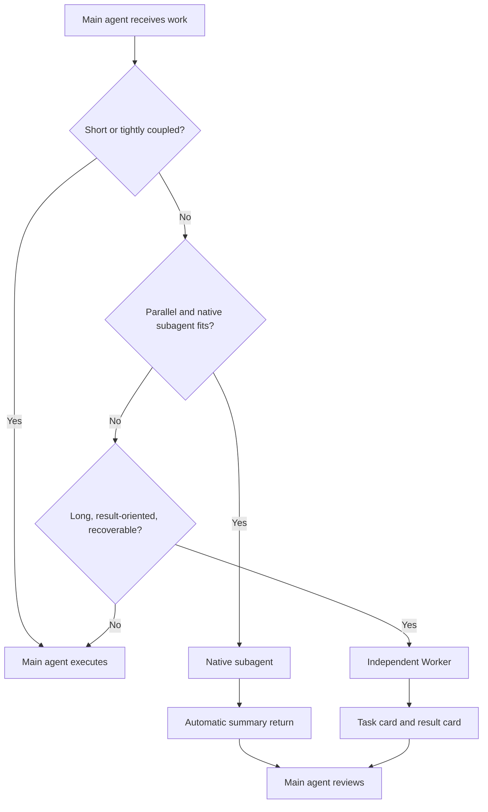
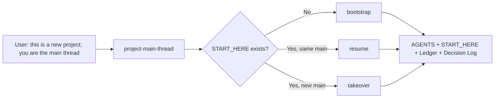
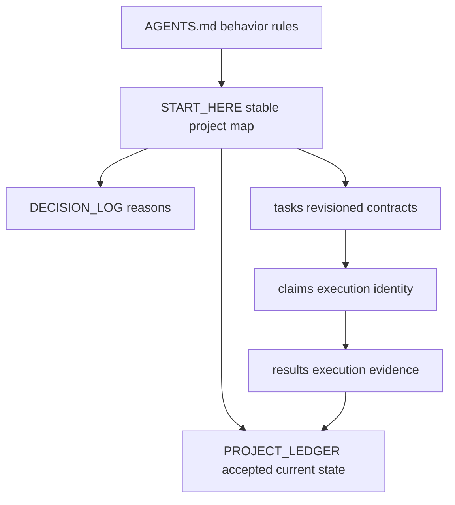

# Architecture and flows

## Three execution paths



## New project and takeover



## Independent Worker handoff

```mermaid
sequenceDiagram
    participant U as User
    participant M as Main agent
    participant F as Project files
    participant W as Independent Worker
    U->>M: Give this long result-only task to a worker
    M->>F: Create task ID and revisioned task contract
    M-->>W: Optional automatic thread creation or Worker Prompt
    W->>F: Create attempt claim
    W->>W: Execute only allowed scope
    W->>F: Write one result card and deliver
    W-->>M: Optional notification
    M->>F: Read result card and verify
    M->>F: Accept, rework, or cancel; update Ledger if needed
```

An independent top-level Codex thread may label its local agent `/root`. That is a runtime-local label, not the project role. Worker identity comes from the explicit launch prompt or assigned task card. The main agent may report a new thread only after a client thread-creation operation succeeds; a task card by itself remains a ready assignment.

## Facts and authority



## Why this is deliberately small

The files act like a durable mailbox and checkpoint layer. This is enough for a personal local workflow. A database or queue becomes useful only when many autonomous workers must coordinate continuously; adding one here would increase operational cost without solving the primary problem, which is main-thread context quality.
